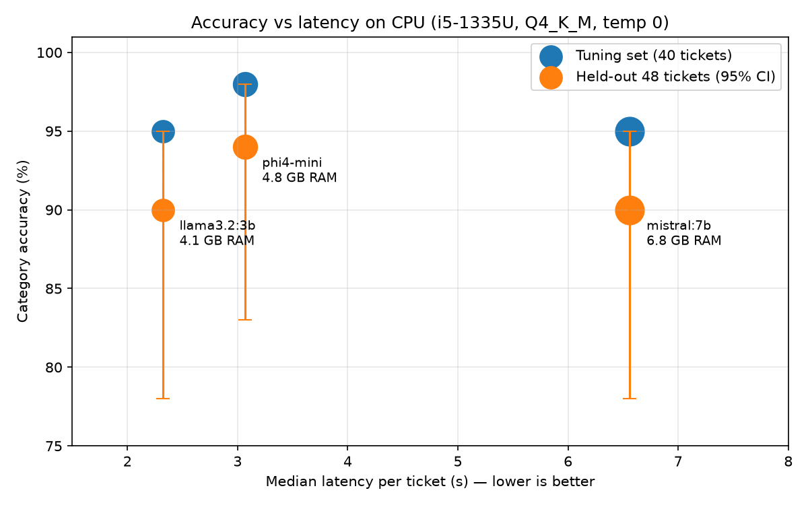

# Local LLM Inference Study


Running open-source LLMs locally on a CPU-only laptop with Ollama: measuring speed, enforcing structured output, and choosing a model with data.

**Hardware:** Intel i5-1335U, 16 GB RAM, no GPU · **Models:** llama3.2:3b, phi4-mini, mistral:7b (Q4_K_M)

## Key results

| Model | Accuracy (tuning set, 40) | Accuracy (held-out, 48) | Latency | Gen tok/s | RAM |
|---|---|---|---|---|---|
| llama3.2:3b | 95% | 90% (CI 78–95%) | 2.3s | 13.8 | 4.1 GB |
| phi4-mini | 98% | 94% (CI 83–98%) | 3.1s | 11.7 | 4.8 GB |
| mistral:7b | 95% | 90% (CI 78–95%) | 6.6s | 5.9 | 6.8 GB |



**Recommendation:** phi4-mini, narrowly. It was best or tied on all three test sets, at half of mistral:7b's latency and 2 GB less RAM. Confidence intervals overlap, so llama3.2:3b (fastest, 100% valid output) is equally defensible when latency matters most.

## What I found

- **Prompt beat model size:** on the tuning set, adding category definitions raised accuracy +15–18 points; moving 3B → 7B gave +8.
- **Held-out labels must match the policy:** llama3.2:3b scored 69% on a held-out set labeled with different rules, but 90% on a 48-ticket set labeled against the same policy as the prompt (95% CI 78–95%). A mismatched answer key made the model look 20 points worse.
- **Format ≠ correctness:** schema-constrained decoding took valid JSON from 0/5 to 5/5, but answers could still be wrong.
- **Prevention beat retry:** stating a rule in the prompt fixed 100% of violations; feedback retries fixed 0/2 and sometimes broke correct fields.
- **Temperature 0 ≠ identical output:** prompt-cache numerics changed near-tied words between runs.
- **Quantization:** Q8 was 1.6–1.8x slower than Q4 with identical classifications, on both llama3.2:3b and phi4-mini.
- **Cold start:** ~12x slower than warm (4.2s vs 0.36s TTFT).
- **Windows `localhost` bug:** IPv6 fallback added ~2s to every request; `127.0.0.1` fixed it.

## Project phases

1. **Inference benchmarks** → [BENCHMARKS.md](docs/BENCHMARKS.md): TTFT, tokens/sec, cold vs warm start
2. **Structured output** → [STRUCTURED_OUTPUT.md](docs/STRUCTURED_OUTPUT.md): JSON schema, Pydantic validation, retry, temperature study
3. **Model comparison** → [MODEL_COMPARISON.md](docs/MODEL_COMPARISON.md): 3 models, held-out tests, label policy ([LABEL_POLICY.md](docs/LABEL_POLICY.md)), quantization

## Run it

```bash
pip install -r requirements.txt
ollama pull llama3.2:3b
uvicorn app:app --reload        # API at http://127.0.0.1:8000/docs
python compare_models.py        # model comparison
```

**API endpoints:** `GET /health` · `POST /generate` (free text) · `POST /classify` (validated JSON ticket triage with retry)

Experiment scripts from Phases 1–2 are in `experiments/` (run from the repo root, e.g. `python experiments/benchmark.py`). Test sets are in `data/`, raw results and logs in `results/`.